<picture>
  <source media="(prefers-color-scheme: dark)" srcset="assets/hero-dark.svg">
  
</picture>

I design and ship LLM systems end to end, from document ingestion to production APIs. Backend roots in **Python** and **TypeScript**, so the AI part holds up in production rather than in a notebook. I run **Outlier**, an independent engineering & creative studio.

 

<picture>
  <source media="(prefers-color-scheme: dark)" srcset="assets/h-capabilities-dark.svg">
  
</picture>

<picture>
  <source media="(prefers-color-scheme: dark)" srcset="assets/capabilities-dark.svg">
  
</picture>

 

<picture>
  <source media="(prefers-color-scheme: dark)" srcset="assets/h-system-dark.svg">
  
</picture>

<a href="https://github.com/tiger440/groundcite">
<picture>
  <source media="(prefers-color-scheme: dark)" srcset="assets/groundcite-dark.svg">
  
</picture>
</a>

| Component | Design choice |
|---|---|
| **Retrieval** | Dense (pgvector) and lexical (Postgres full-text), fused with reciprocal rank fusion, then reranked |
| **Citations** | Every claim points at exact `(document, start, end)` character offsets, preserved through parsing and chunking |
| **Permissions** | ACL filters applied inside the index scan, never as a post-filter — recall measured per scope |
| **Evals** | Each stage of the funnel measured separately, paired bootstrap confidence intervals |
| **Storage** | Postgres only. No managed vector service |

**[Repository →](https://github.com/tiger440/groundcite)** &nbsp;&nbsp; **[ML companion docs →](https://tiger440.github.io/groundcite/)** &nbsp;&nbsp; Also: [n8n-ready](https://github.com/tiger440/n8n-ready), a ready-to-use automation base

 

<picture>
  <source media="(prefers-color-scheme: dark)" srcset="assets/h-stack-dark.svg">
  
</picture>

<picture>
  <source media="(prefers-color-scheme: dark)" srcset="assets/stack-dark.svg">
  
</picture>

 

<picture>
  <source media="(prefers-color-scheme: dark)" srcset="assets/contact-dark.svg">
  
</picture>

Off-duty — MMA · chess as [he-huizheng](https://www.chess.com/member/he-huizheng) · fashion design
