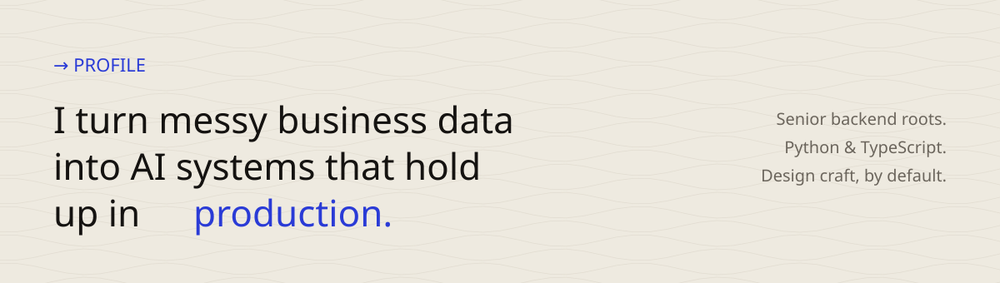
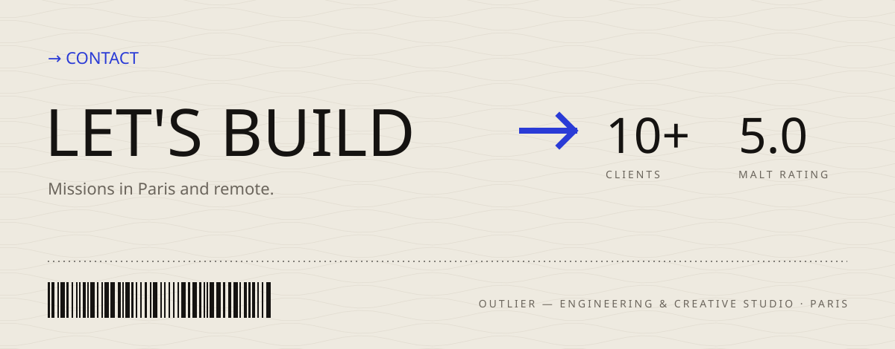

  <a href="https://github.com/tiger440/groundcite"><b>groundcite</b></a> &nbsp;·&nbsp;
  <a href="https://tiger440.github.io/groundcite/"><b>groundcite docs</b></a> &nbsp;·&nbsp;
  <a href="https://github.com/tiger440/n8n-ready"><b>n8n-ready</b></a>
   
  Off-duty — Mixed Martial Arts · chess as <a href="https://www.chess.com/member/he-huizheng">he-huizheng</a> · fashion design

